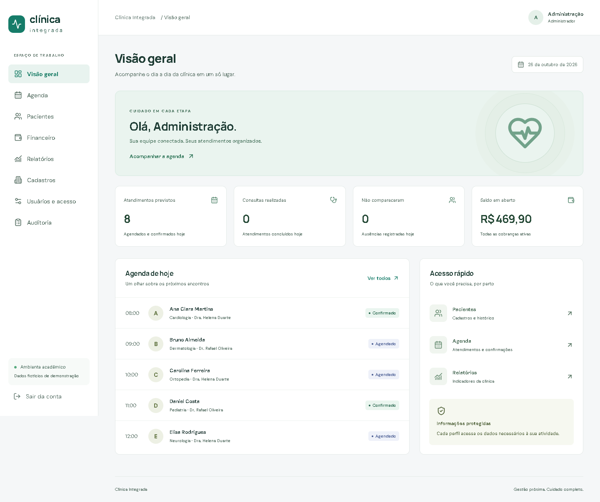

# Clínica Integrada

Sistema acadêmico de gestão de clínica médica, com aplicação funcional em português, React + TypeScript, Express + TypeScript, Prisma e PostgreSQL 17. Os dados demonstrativos são fictícios.



## Executar no Windows

Requer Node.js 22 ou 24 e npm. Não é necessário instalar PostgreSQL no Windows: a opção local inicia um PostgreSQL real com binários do pacote `embedded-postgres`. Docker e PostgreSQL externo também são suportados.

Na pasta do projeto, execute uma vez:

```powershell
npm.cmd ci
Copy-Item .env.example .env
npm.cmd run db:generate
```

Não sobrescreva um `.env` que você já tenha configurado. Nesta entrega, as dependências, o `.env` local e o banco demonstrativo já foram preparados.

**Terminal 1 — mantenha aberto:**

```powershell
npm.cmd run db:local
```

**Terminal 2 — inicializar e executar:**

```powershell
npm.cmd run db:migrate
npm.cmd run db:seed
npm.cmd run dev
```

Acesse **http://127.0.0.1:5173**. A API usa a porta 3001. Para servir a compilação completa em uma porta: `npm.cmd run build`, depois `npm.cmd start` e acesse **http://127.0.0.1:3001**. Não execute os dois modos simultaneamente na mesma porta.

| Perfil | E-mail de demonstração |
|---|---|
| Administrador | admin@clinica.local |
| Recepcionista | recepcao@clinica.local |
| Médico responsável | medico@clinica.local |
| Segundo médico | medico2@clinica.local |
| Enfermagem | enfermagem@clinica.local |
| Financeiro | financeiro@clinica.local |

Senha inicial de todas as contas: **Clinica@2026**. É uma credencial pública e fictícia de demonstração. O seed não sobrescreve um banco já inicializado. As contas clínicas estão vinculadas aos respectivos profissionais.

## Entrega acadêmica

1. [Visão geral e decisões de escopo](docs/01-visao-geral.md)
2. [Requisitos, regras e permissões](docs/02-requisitos.md)
3. [Squads e aplicação do Scrum](docs/03-scrum.md)
4. [Backlog e seis Sprints](docs/04-backlog-sprints.md)
5. [Casos de uso detalhados](docs/05-casos-de-uso.md) · [PlantUML](docs/diagramas/casos-de-uso.puml) · [Imagem SVG](docs/diagramas/casos-de-uso.svg)
6. [Diagrama de classes](docs/06-classes.md) · [PlantUML completo](docs/diagramas/classes.puml) · [Imagem SVG](docs/diagramas/classes.svg)
7. [Modelagem do banco](docs/07-banco.md) · [Dicionário completo](docs/dicionario-dados.md) · [DER PlantUML](docs/diagramas/entidade-relacionamento.puml) · [DER SVG](docs/diagramas/entidade-relacionamento.svg)
8. [Aplicação, arquitetura e API](docs/08-aplicacao-api.md)
9. [Testes e resultados verificados](docs/09-testes.md)
10. [Manual e roteiro de demonstração](docs/10-manual.md)
11. [Matriz final de rastreabilidade e cobertura](docs/11-rastreabilidade.md)

## Verificação

```powershell
npm.cmd run build
npm.cmd test
npm.cmd run docs
npm.cmd audit
```

Os testes usam exclusivamente o PostgreSQL local, no banco `clinica_test`, criando um schema novo a cada execução. Aplicam migrations e fixtures nesse schema vazio, sem limpar dados existentes. A URL da Neon é ignorada pelo executor de testes.

Correção de produção e validações mais recentes: [Agenda na Neon/Vercel](docs/correcao-agenda-neon.md).

Para repetir os testes de navegador, rode `npm.cmd test` antes, inicie `node scripts/servidor-teste.mjs` em outro terminal e execute `node scripts/verificar-interface.mjs`. O roteiro usa Microsoft Edge instalado no Windows e grava capturas em `docs/evidencias/`.

## Limites explícitos

O núcleo solicitado está implementado e os resultados efetivamente verificados estão no relatório de testes. Não há integração com operadoras, laboratórios, emissão fiscal ou assinatura digital. Relatórios financeiros representam a posição atual dos lançamentos; não há fechamento contábil histórico. Acessibilidade integral, carga com milhares de registros, operação multi-instância e conformidade legal não estão certificadas. Consulte os requisitos não funcionais e os limites detalhados nos documentos.
